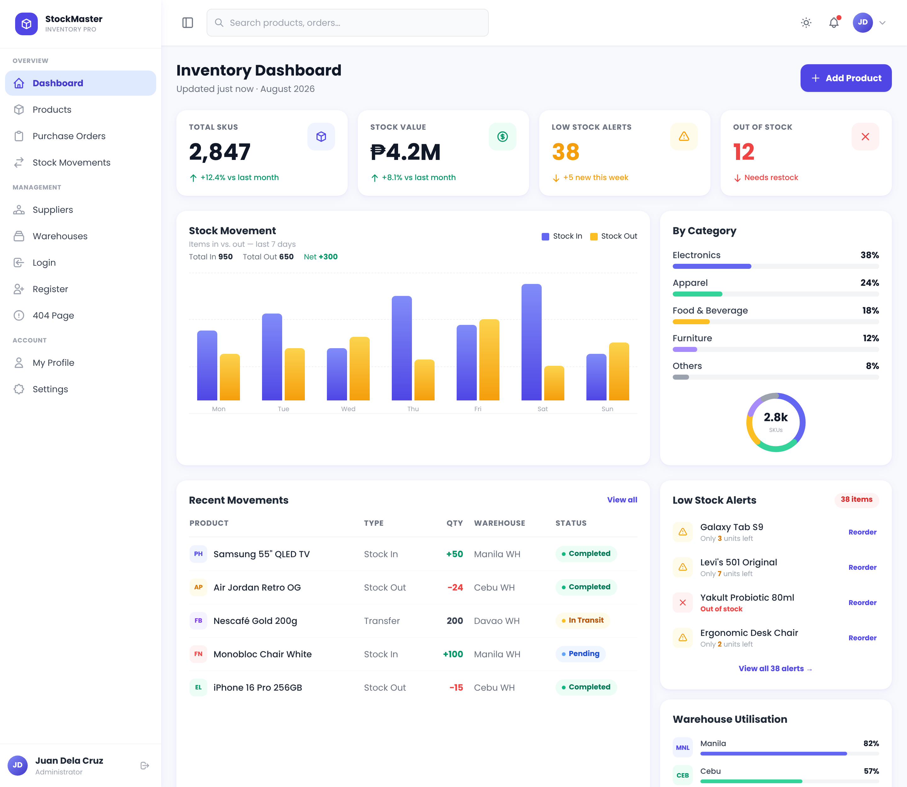
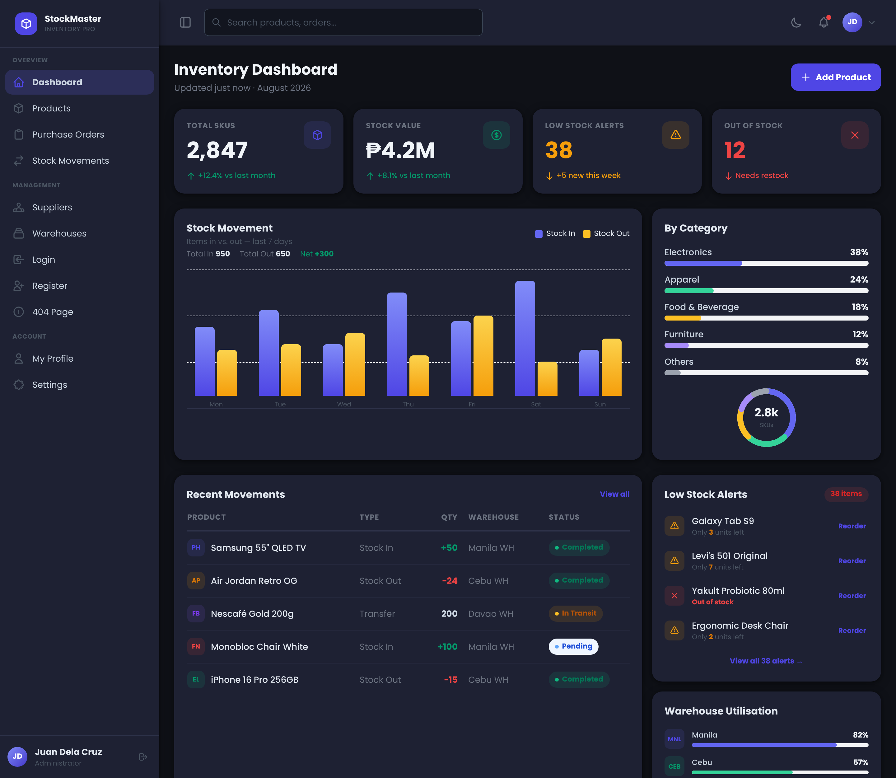
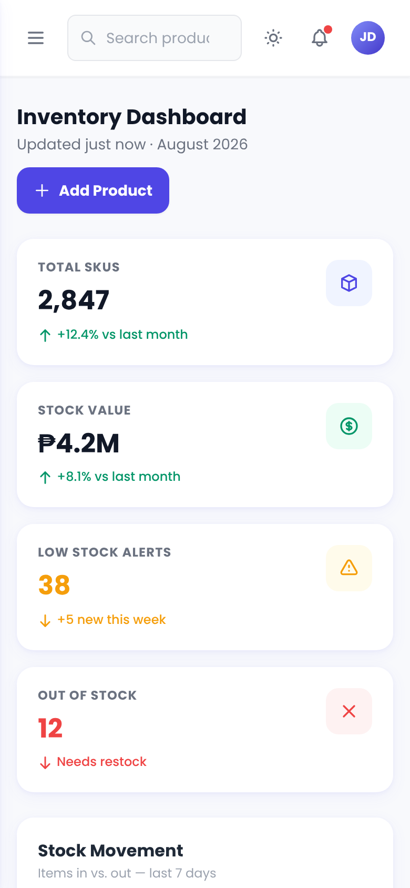
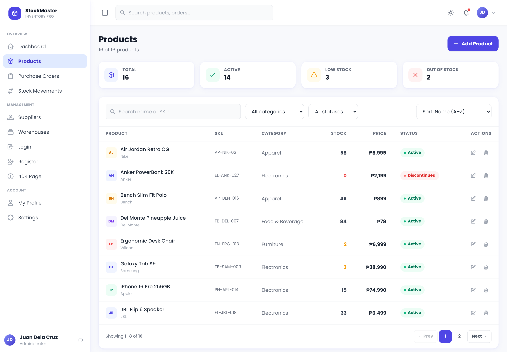
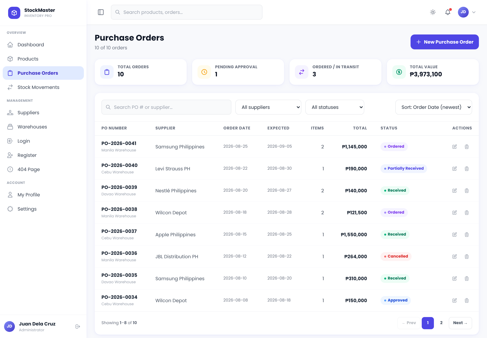
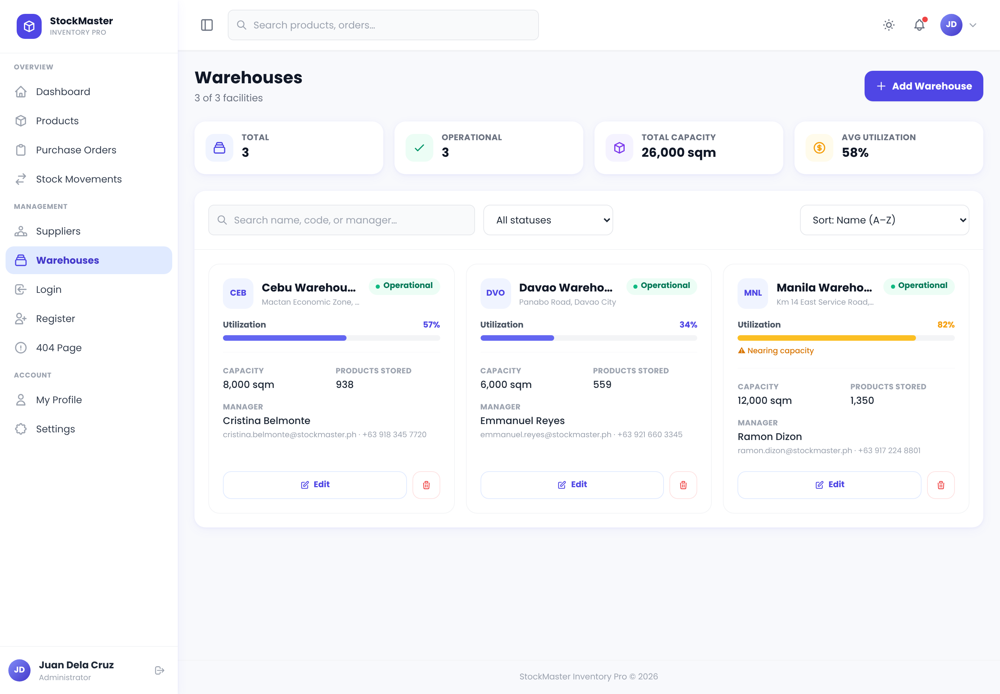

# StockMaster Inventory Pro

> A clean, fully responsive **inventory management dashboard** built with HTML, Tailwind CSS, and Alpine.js — no build tools, no backend required.


🔗 **Live Demo:** [stockmaster-tailwind-dashboard.vercel.app](https://stockmaster-tailwind-dashboard.vercel.app/)



---

## Features

- **Inventory Dashboard** — KPI stat cards, 7-day stock movement bar chart, category breakdown with donut chart, recent movements, low-stock alerts and warehouse utilisation
- **Products** — searchable, filterable and sortable product table with pagination, edit/delete actions and a multi-step *Add Product* modal with validation
- **Purchase Orders** — order listing with status badges and approval workflow UI
- **Stock Movements** — transfer log with in / out / transfer types and warehouse tags
- **Suppliers** — supplier directory with performance ratings
- **Warehouses** — utilisation bars per warehouse location
- **Profile** — user profile page with activity feed
- **Auth pages** — Login and Register
- **404 page** — custom error page
- **Dark mode** — persisted via `localStorage`, respects `prefers-color-scheme`
- **Collapsible sidebar** — icon-only on desktop, off-canvas on mobile
- **Accessible** — skip links, `aria-*` attributes, focus traps in modals, keyboard navigation

---

## Screenshots

| Dark mode | Mobile |
|---|---|
|  |  |

| Products | Purchase Orders |
|---|---|
|  |  |

| Warehouses |
|---|
|  |

---

## Tech Stack

| Layer | Technology |
|---|---|
| Markup | HTML5 (multi-page, no framework) |
| Styling | [Tailwind CSS](https://tailwindcss.com/) via CDN + custom `style.css` |
| Interactivity | [Alpine.js v3](https://alpinejs.dev/) via CDN |
| Typography | [Poppins](https://fonts.google.com/specimen/Poppins) (Google Fonts) |
| Deployment | [Vercel](https://vercel.com/) (any static host works) |

No npm, no bundler, no backend. Drop the files on any static host and it works.

> **Note:** Tailwind, Alpine.js and Google Fonts are loaded from CDNs, so an internet connection is needed on first load.

---

## Getting Started

```bash
git clone https://github.com/your-username/stockmaster-tailwind-dashboard.git
cd stockmaster-tailwind-dashboard
```

Open `index.html` in your browser, or serve it locally:

```bash
# Python
python -m http.server 3000

# Node
npx serve .
```

Then visit `http://localhost:3000`.

---

## Project Structure

```
stockmaster-tailwind-dashboard/
├── index.html              # Dashboard (main page)
├── products.html           # Product catalog + Add/Edit/Delete
├── purchase-orders.html    # Purchase orders
├── stock-movements.html    # Stock movement log
├── suppliers.html          # Supplier directory
├── warehouses.html         # Warehouse utilisation
├── profile.html            # User profile
├── login.html              # Sign-in page
├── register.html           # Sign-up page
├── 404.html                # Not found page
└── assets/
    ├── preview.png         # README hero image
    ├── screenshots/        # README gallery images
    ├── css/
    │   └── style.css       # Custom styles (sidebar, charts, modal, dark mode)
    └── js/
        └── main.js         # Shared logic (dark mode, sidebar, notifications, toast)
```

---

## Pages

| Page | File | Description |
|---|---|---|
| Dashboard | `index.html` | KPI cards, charts, recent movements, alerts |
| Products | `products.html` | Product table, filters, Add Product modal |
| Purchase Orders | `purchase-orders.html` | PO list with status tracking |
| Stock Movements | `stock-movements.html` | In / out / transfer log |
| Suppliers | `suppliers.html` | Supplier directory |
| Warehouses | `warehouses.html` | Warehouse utilisation |
| Profile | `profile.html` | User account page |
| Login | `login.html` | Sign-in form |
| Register | `register.html` | Sign-up form |
| 404 | `404.html` | Not found page |

---

## Dashboard Widgets

- **Stat cards** — Total SKUs, Stock Value, Low Stock Alerts, Out of Stock
- **Stock Movement** — grouped bar chart (Stock In vs Out) for the last 7 days
- **By Category** — progress bars plus an SVG donut chart
- **Recent Movements** — table with type, quantity, warehouse and status badges
- **Low Stock Alerts** — quick reorder list
- **Warehouse Utilisation** — progress bars per location

---

## Customisation

Sample data lives in plain JavaScript arrays inside each page's Alpine component. To connect a real backend, replace the static arrays with `fetch()` calls in the component's `init()` hook.

**Brand colours** are set in the Tailwind config block at the top of each HTML file:

```js
tailwind.config = {
  theme: {
    extend: {
      colors: {
        brand: {
          50: '#f0f4ff', 400: '#818cf8',
          500: '#6366f1', 600: '#4f46e5', 700: '#4338ca',
        }
      }
    }
  }
}
```

Swap the hex values to rebrand the whole UI.

---

## Browser Support

All modern browsers (Chrome, Firefox, Safari, Edge). JavaScript must be enabled.

---

## License

MIT — free to use, modify, and distribute.

---

## Author

Built with ❤️ using Tailwind CSS + Alpine.js.
